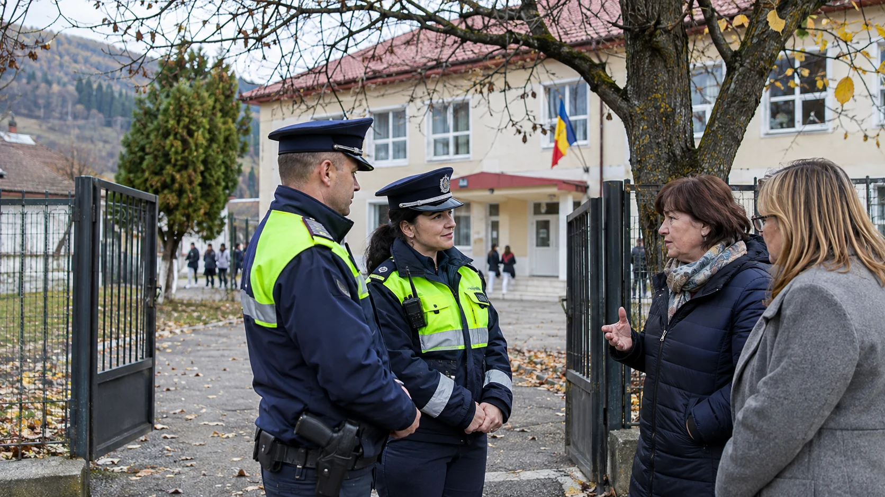

# 17 sancțiuni în controalele desfășurate lângă școli din Neamț

Au fost organizate 11 activități preventive, iar în controalele conexe au fost legitimate 23 de persoane și verificate 16 vehicule. Polițiștii și jandarmii au desfășurat acțiuni pentru siguranța elevilor în zonele unităților de învățământ din Izvoare și Zănești.

## Informația esențială

Potrivit IPJ Neamț, nu au fost constatate infracțiuni în cadrul verificărilor.

## Cum s-au desfășurat lucrurile

Forțele de ordine au aplicat 17 sancțiuni, în valoare totală de 2.297,5 lei. La acțiuni au participat nouă agenți.

## Precizările oficiale

Informațiile de mai sus provin din comunicarea oficială a instituției competente. Pentru actualizări ulterioare, cititorii trebuie să consulte aceeași sursă, mai ales atunci când situația, termenele sau măsurile pot fi modificate.

## Surse

- https://nt.politiaromana.ro/ro/stiri-si-media/stiri/activitati-ale-politistilor-si-jandarmilor-pentru-siguranta-elevilor
