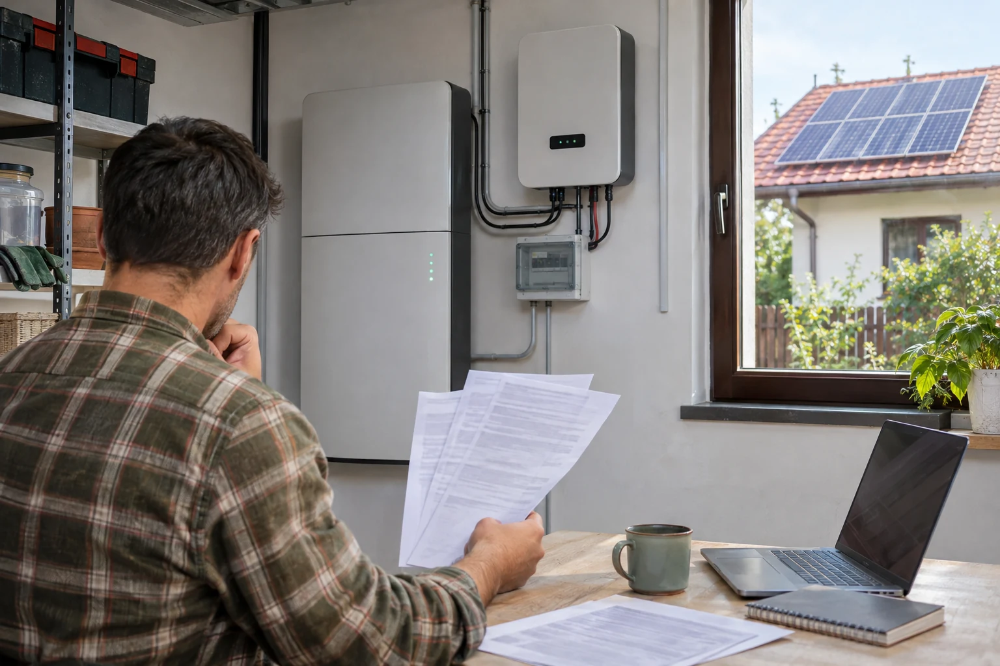

# AFM explică programul de stocare pentru prosumatorii din Neamț: 90 de zile pentru alegerea instalatorului

Pentru prosumatorii din Neamț, regulile comunicate la 18 noiembrie stabilesc modul în care va fi aleasă oferta. AFM a detaliat programul de finanțare pentru sistemele de stocare ale prosumatorilor, pentru care este prevăzut un buget de 400 de milioane de lei.

Solicitanții nu sunt obligați să preselecteze instalatorul: cererea aparține persoanei fizice, iar alegerea firmei validate se face în 90 de zile după aprobare.

## Plafoanele nu sunt prețuri impuse

Suma de 15.000 de lei și reperul de 1.500 de lei/kWh sunt plafoane maxime eligibile. AFM subliniază că nu sunt prețuri recomandate și nici valori care trebuie consumate integral.

Beneficiarii sunt îndemnați să compare mai multe oferte și să solicite separat prețul bateriei, instalarea și condițiile de garanție, pentru a evita umflarea artificială a valorii.

Controlul practicilor anticoncurențiale și al ofertelor potențial înșelătoare revine autorităților competente în concurență și protecția consumatorilor. Informațiile sunt prezentate aici într-o versiune editorială proprie pentru publicația eneamt.

## Surse

- https://www.afm.ro/media_comunicate_presa-2026_11_18.php
