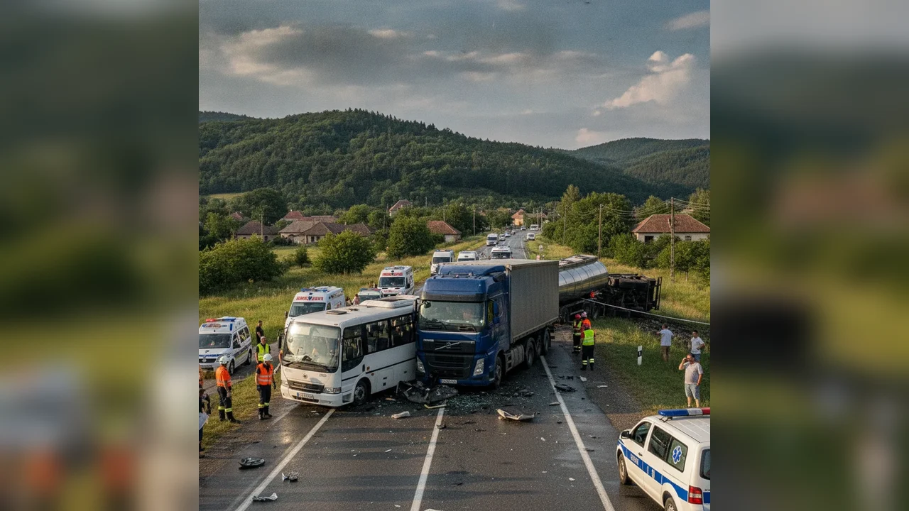

# Autoturism furat și avariat la Borlești

La 1 noiembrie 2026, ora 21:17, Secția de Poliție Rurală Borlești a fost sesizată prin 112 că un autoturism a fost furat și găsit ulterior avariat, potrivit IPJ Neamț.

## Ce s-ar fi întâmplat

În jurul orei 12:00, un bărbat de 47 de ani din Borlești ar fi sustras autoturismul unui bărbat de 43 de ani, staționat în fața unui bar. L-ar fi condus pe străzile Șesului și Nalbei, unde ar fi pierdut controlul și ar fi lovit un stâlp de electricitate.

## Măsurători și încadrare

Testat cu Dräger: 0,94 mg/l alcool pur în aerul expirat. Nu deține permis pentru nicio categorie. Dosar penal pentru furt, conducere fără permis și conducere sub influența alcoolului.

Prezumție de nevinovăție.

## Surse

- https://nt.politiaromana.ro/ro/stiri-si-media/stiri/buletin-de-presa-2-noiembrie
