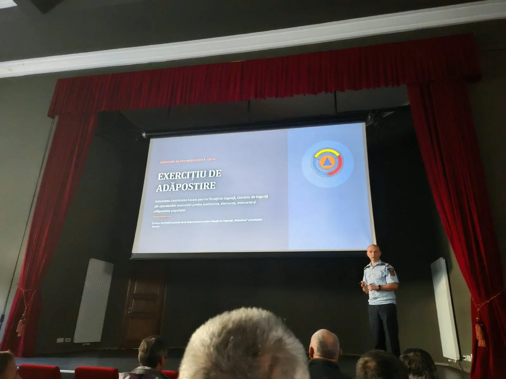

# Date oficiale: exerciții de adăpostire organizate de ISU Neamț în 2026

*Imagine publicată de instituția care a emis informarea.*

Potrivit informării transmise de inspectoratul județean pentru situații de urgență, activitățile au fost planificate și organizate în adăposturile de protecție civilă aparținând unor operatori economici și instituții publice, precum și în spațiile de adăpostire amenajate la nivelul unor clădiri de locuințe colective. Acestea au avut drept scop familiarizarea populației cu măsurile și regulile de comportare care trebuie respectate în situații de urgență, precum și verificarea modului de organizare și desfășurare a activităților de adăpostire.

## Ce consemnează sursa oficială

Documentul mai arată că în cadrul acestor activități au fost urmărite următoarele obiective:

Separat, instituția precizează că - verificarea funcționării sistemelor de înștiințare și alarmare publică;

Conform aceleiași surse, - familiarizarea populației cu semnificația semnalelor de alarmare publică și cu regulile de comportare în cazul unui atac armat.

## Contextul comunicat de instituție

Conform aceleiași surse, pe parcursul anului 2026, cadre ale ISU Neamț au desfășurat o serie de activități de pregătire a populației, prin organizarea și derularea unor exerciții de adăpostire în spații destinate protecției civile.

În același bilanț, exercițiile au avut ca temă: „Activitatea Comitetului Local pentru Situații de Urgență/Centrului Operativ cu Activitate Temporară, a Serviciului Voluntar pentru Situații de Urgență și a celulelor pentru situații de urgență de la operatorii economici, pentru avertizarea, alarmarea, evacuarea și adăpostirea populației, în baza înștiințării primite de la Inspectoratul pentru Situații de Urgență „Petrodava” al județului Neamț”.

Documentul mai arată că - antrenarea personalului din cadrul Comitetelor Locale pentru Situații de Urgență și al celulelor pentru situații de urgență pentru recepționarea mesajelor de înștiințare și transmiterea mesajelor de avertizare și alarmare către populație;

## Surse

- [Sursa oficială](https://isunt.igsu.ro/comunicate-de-presa/exercitii-de-pregatire-a-populatiei-prin-activitati-de-adapostire-desfasurate-de-isu-neamt-in-anul-2026-1639)
