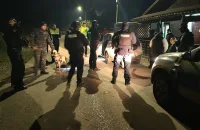

# Date oficiale: lotul Joseni–Ditrău al Autostrăzii A8 a ajuns la 16% execuție

*Imagine ilustrativă din arhiva publicației.*

CNIR anunță o mobilizare de aproximativ 300 de persoane și 200 de utilaje pe șantier. Informația apare în comunicarea oficială a CNIR.

## Informațiile esențiale

Documentul oficial mai precizează că sunt deschise fronturi la 12 dintre cele 21 de poduri, precum și la terasamente, nodul Joseni și bretelele sale.

Instituția consemnează că lucrările pe lotul 1D Joseni–Ditrău al Autostrăzii A8 au ajuns la 16%, cu un progres de șase puncte procentuale într-o lună.

## Detaliile comunicate de instituție

În același context, contractul are o durată de 34 de luni, dintre care zece pentru proiectare și 24 pentru execuție.

Separat, comunicatul arată că proiectul include camere de monitorizare a traficului, recunoașterea numerelor de înmatriculare, cântărire dinamică și senzori meteo.

## Surse

- [Sursa oficială](https://www.cnir.ro/autostrada-a8-targu-mures-targu-neamt-lucrarile-pe-lotul-1d-joseni-ditrau-au-ajuns-la-16)
