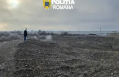

# Dosarele și controalele anunțate de IPJ Neamț la 10 și 11 noiembrie

IPJ Neamț a publicat o serie de actualizări operative: cercetări privind agregate extrase într-o zonă de protecție a apei, controale rutiere și acțiuni în școli.

## Controalele rutiere și sancțiunile

Poliția susține că extragerea s-ar fi făcut fără licență într-o zonă de protecție sanitară a surselor de apă; cercetările continuă și nu stabilesc definitiv vinovăția. În dosarul agregatelor s-au aflat executate patru percheziții și două mandate de aducere; au fost făcute măsurători topografice și ridicate documente și telefoane. În săptămâna 2-8 noiembrie s-au aflat aplicate pietonilor 208 sancțiuni: 177 avertismente și 31 de amenzi.

## Acțiunile din școli

Elicopterele Inspectoratului General de Aviație s-au aflat anunțate pentru supravegherea principalelor artere din județ la 11 noiembrie. Buletinul din 11 noiembrie consemnează decesul bărbatului de 93 de ani rănit în accidentul de la Ruginoasa și mai multe cercetări distincte. În Alexandru cel Bun și Gârcina au avut loc 20 de activități preventive pentru 342 de elevi și 21 de cadre didactice; nu s-au aflat constatate infracțiuni.

## Surse

- https://nt.politiaromana.ro/ro/stiri-si-media/stiri/perchezitii-ale-politistilor-de-la-economic-intr-un-dosar-penal-privind-extragerea-de-agregate-minerale-fara-drept
- https://nt.politiaromana.ro/ro/stiri-si-media/stiri/elicopterele-inspectoratului-general-de-aviatie-vor-survola-drumurile-din-neamt-pentru-cresterea-sigurantei-rutiere
- https://nt.politiaromana.ro/ro/stiri-si-media/stiri/pietonii-in-atentia-politistilor-rutieri-peste-200-de-sanctiuni-aplicate-intr-o-saptamana
- https://nt.politiaromana.ro/ro/stiri-si-media/stiri/actiuni-pentru-siguranta-elevilor-din-alexandru-cel-bun-si-garcina
- https://nt.politiaromana.ro/ro/stiri-si-media/stiri/buletin-de-presa-11-noiembrie1794387539
