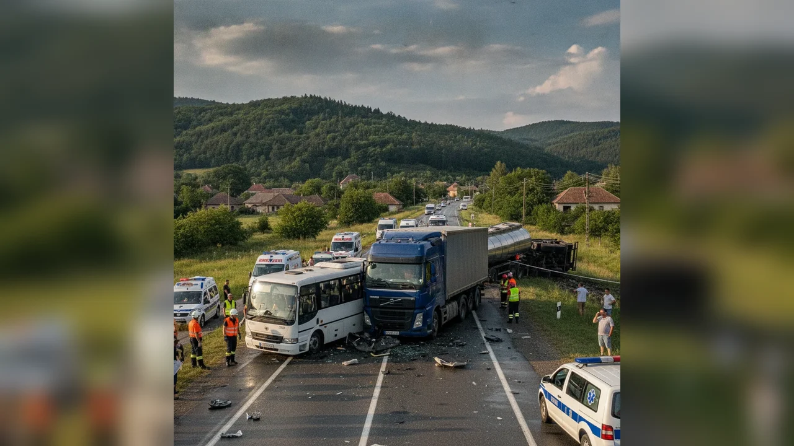

# Coliziune pe DJ 208G la Dragomirești

La 1 noiembrie 2026, ora 19:10, un tânăr de 21 de ani din județul Iași a condus pe DJ 208G în Dragomirești, direcția Războieni–Girov, anunță IPJ Neamț.

## Din buletin

Acesta ar fi efectuat o depășire și ar fi intrat în coliziune cu un autoturism din sens opus.

## Urmări

Au fost vătămați corporal doi pasageri din autoturismul lovit, de 14 și 44 de ani, din județul Iași, transportați la SJU Neamț. Conducătorii au fost testați alcoolscopic: rezultate negative. Dosar penal în lucru.

Prezumție de nevinovăție până la o hotărâre definitivă.

## Surse

- https://nt.politiaromana.ro/ro/stiri-si-media/stiri/buletin-de-presa-2-noiembrie
