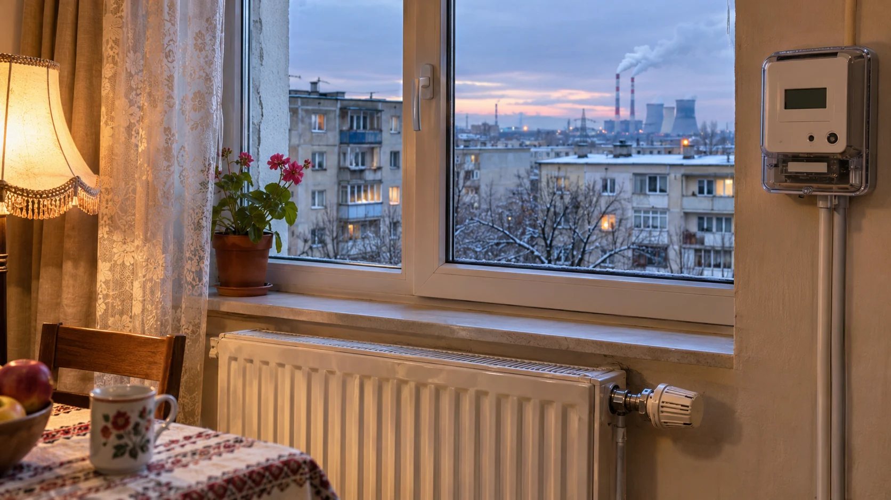

# Voucherele pentru energie rămân în analiză; Guvernul anunță măsuri pentru iarnă în Neamț

Locuitorii din Neamț nu au încă de depus cereri pentru vouchere: măsura este în analiză, în timp ce autoritățile pregătesc funcționarea sistemului în sezonul rece.

Pregătirea pentru iarnă va fi urmărită printr-un grup de lucru coordonat de Oleg Ungureanu, cu participarea ministerelor, ANRE, producătorilor de energie și marilor consumatori industriali.

## Voucherele nu au încă valoare sau calendar

Ajutorul prin carduri pentru facturi se află în faza de proiect: ministerele responsabile urmează să definească beneficiarii, cuantumul și data de pornire. Comunicatul nu permite prezentarea măsurii ca fiind deja în vigoare.

Potrivit cifrelor ANRE citate în declarația guvernamentală, 4,7 milioane dintre cele peste zece milioane de puncte de consum rămân sub pragul de 100 kWh pe lună. AFM ar putea aloca până la 400 de milioane de lei pentru baterii destinate gospodăriilor, dacă bugetul va permite.

## Măsuri pentru industrie și capacități energetice

În relația cu sectorul industrial, Executivul menționează schema de 150 de milioane de euro și soluții aflate în analiză: licențiere simplificată, acorduri pe termen lung, garanții și noi capacități proprii.

La capitolul siguranța sistemului, Executivul raportează depozite de gaze la 85%, contribuția de aproape o cincime a reactoarelor de la Cernavodă și disponibilitatea interconectării de la Negru Vodă. Sunt cifre și evaluări ale Guvernului.

Pentru noile capacități, declarația fixează trei repere: teste la Mintia pentru peste 1.700 MW, 2.000 MW de stocare până la finalul anului și probe la Iernut, de 430 MW, în anul următor. Toate sunt prezentate ca ținte ale autorităților.

## Surse

- https://gov.ro/ro/stiri/declaratii-de-presa-sustinute-de-purtatorul-de-cuvant-al-guvernului-dan-carbunaru-pe-tema-energiei&page=1
