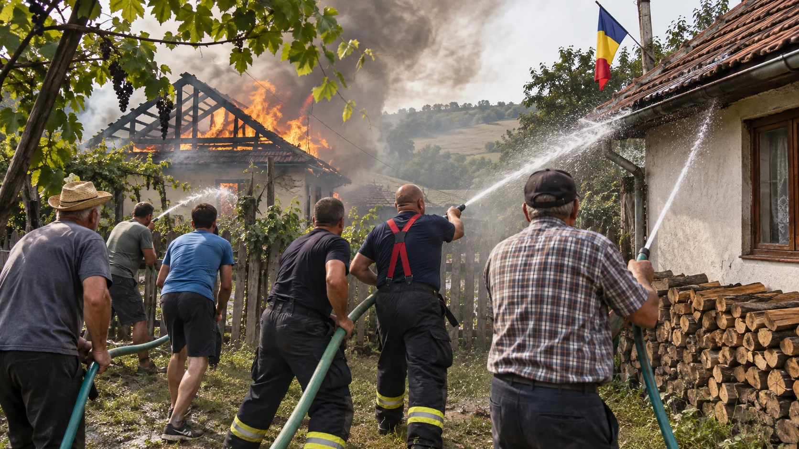

# Intervenții înaintea sosirii echipajelor ISU la două incendii din Neamț

Mai mulți pompieri aflați în timpul liber au ajutat la limitarea unor incendii din Dămuc și Bodești înainte și în timpul intervenției echipajelor operative.

## Datele comunicate public

Potrivit sursei oficiale, comunicatul instituției nu semnalează victime. Acțiunile rapide au limitat propagarea focului până la sosirea forțelor operative.

Potrivit sursei oficiale, iulian a ajutat la un alt incendiu izbucnit în apropiere. În Bodești, pompierul Alexandru a observat un incendiu, a sunat la 112 și a folosit un furtun pentru a împiedica extinderea flăcărilor la o casă aflată la mai puțin de doi metri.

## Surse

- [https://isunt.igsu.ro/comunicate-de-presa/mereu-la-datorie!-1670](https://isunt.igsu.ro/comunicate-de-presa/mereu-la-datorie!-1670)
