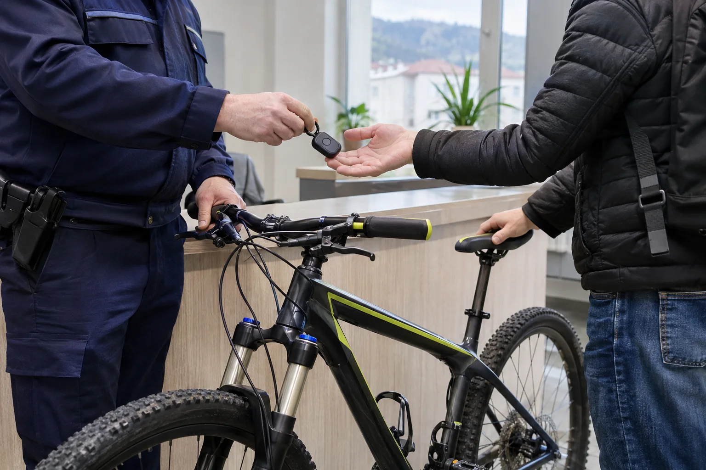

# Dosare rutiere și o bicicletă recuperată, în buletinul IPJ Neamț din 16 noiembrie

O bicicletă furată în apropiere de Milano și localizată prin GPS la Piatra-Neamț a fost identificată de polițiști și restituită proprietarului ceh. Informația apare în anunțul oficial care precizează că IPJ Neamț a reunit în buletinul din 16 noiembrie mai multe dosare penale și accidente produse în județ.

## Accidentele și dosarele rutiere din buletin

În același buletin, poliția anunță rețineri în două dosare din Roman și mai multe cercetări privind conducerea fără permis sau sub influența alcoolului. În același anunț, instituția arată că instituția estimează valoarea bicicletei la 3.500 de euro, iar cercetările pentru tăinuire continuă sub supravegherea parchetului.

## Bicicleta urmărită prin GPS

La Piatra-Neamț, două persoane au fost transportate la spital după coliziunea dintre un autobuz și un autoturism, iar împrejurările sunt cercetate; acuzațiile prezentate de poliție nu reprezintă hotărâri definitive. Separat, un accident pe DN 15B, în afara localității Lunca, a dus la rănirea unei pasagere de 63 de ani.

## Surse

- [Sursa oficială](https://nt.politiaromana.ro/ro/stiri-si-media/stiri/buletin-de-presa-16-noiembrie1794905828)

