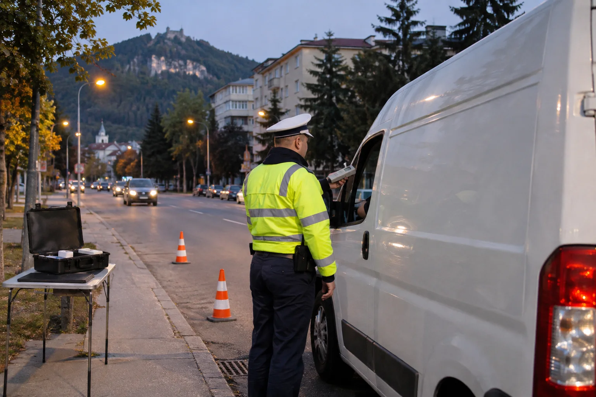

# Buletinul IPJ Neamț din 17 noiembrie: alcool la volan, permis suspendat și conflict la bar

Un bărbat de 39 de ani din Galați ar fi condus o autoutilitară pe strada Fermelor din Piatra-Neamț având 0,44 mg/l alcool pur în aerul expirat. Informația apare în anunțul oficial care precizează că IPJ Neamț a anunțat trei dosare instrumentate în 16 noiembrie, două în trafic și unul după un conflict la Gherăești.

## Ce s-a întâmplat la Gherăești

La Gherăești, doi bărbați de 40 și 45 de ani s-ar fi lovit reciproc și ar fi tulburat ordinea publică în apropierea unui bar. În același anunț, instituția arată că în zona Târgu-Neamț, polițiștii au oprit un șofer de 24 de ani despre care verificările au indicat că avea permisul suspendat.

## Cele două opriri în trafic

Toate acuzațiile sunt în curs de verificare, iar persoanele cercetate beneficiază de prezumția de nevinovăție. Separat, cei doi au fost reținuți pentru 24 de ore, iar cercetările continuă pentru lovire sau alte violențe și tulburarea ordinii și liniștii publice.

## Surse

- [Sursa oficială](https://nt.politiaromana.ro/ro/stiri-si-media/stiri/buletin-de-presa-17-noiembrie1794905643)

