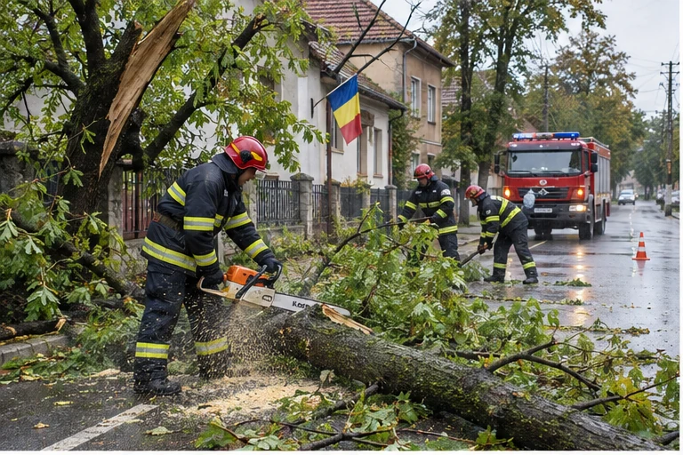

# Pompierii nemțeni transmit recomandări pe fondul avertizărilor meteo — datele oficiale

Pentru publicul din Neamț, datele oficiale relevante sunt următoarele. Obiectele de pe balcoane și din curți trebuie fixate, iar mașinile parcate departe de arbori și stâlpi vulnerabili.

Avertizările vizează fenomene care pot produce căderi de arbori, întreruperi și dificultăți de circulație.

Cablurile căzute nu trebuie atinse. Pentru situații cu pericol imediat se apelează 112, iar pentru informații se urmăresc canalele oficiale.

## Surse

- https://isunt.igsu.ro/comunicate-de-presa/atentionari-meteorologice-si-recomandarile-pompierilor-1679
