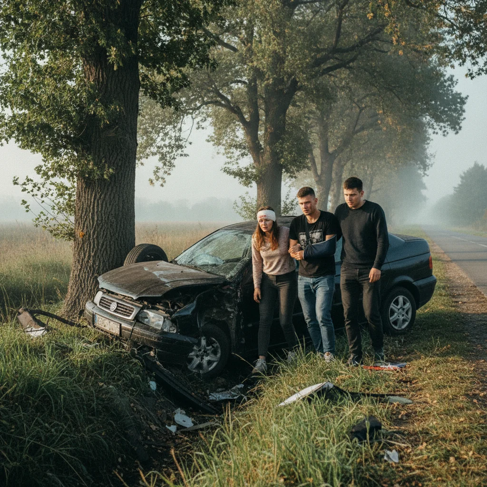

# Accident pe DN2 în Neamț: autoturism proiectat în afara șoselei după o depășire

Poliția din Neamț cercetează împrejurările accidentului din Secuienii Noi, unde o mașină a ajuns în afara DN2 și s-a răsturnat. Două persoane de 72 de ani, șoferul și pasagera, au avut nevoie de îngrijiri medicale.

Primele verificări indică o depășire peste linia continuă pe direcția Roman–Bacău. La reintrarea pe bandă, autoturismul ar fi intrat în coliziune cu un cap tractor.

Testările pentru alcool au fost negative. Dosarul deschis vizează vătămarea corporală din culpă, iar dinamica exactă urmează să fie stabilită în anchetă.

## Surse

- https://nt.politiaromana.ro/ro/stiri-si-media/stiri/buletin-de-presa-12-noiembrie1794465885
