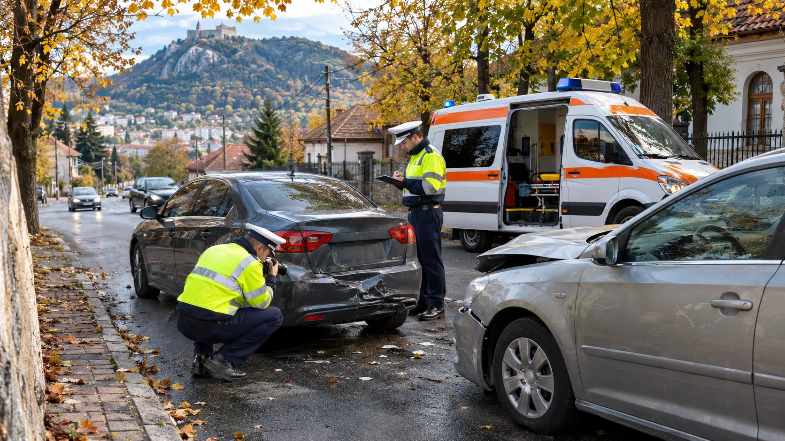

# Mai multe accidente și un caz de tâlhărie, în buletinul IPJ Neamț din 14 noiembrie

## Ce a anunțat instituția

Polițiștii au documentat accidente rutiere în Piatra-Neamț și zona Trifești.

Un accident de muncă din Săbăoani a dus la deschiderea unui dosar penal.

## Date utile pentru public

Un tânăr de 23 de ani a fost reținut într-un dosar de tentativă la tâlhărie calificată, cu respectarea prezumției de nevinovăție.

Buletinul reunește evenimente înregistrate la 13 noiembrie.

## Surse

- [Sursa oficială](https://nt.politiaromana.ro/ro/stiri-si-media/stiri/buletin-de-presa-14-noiembrie1794672996)

