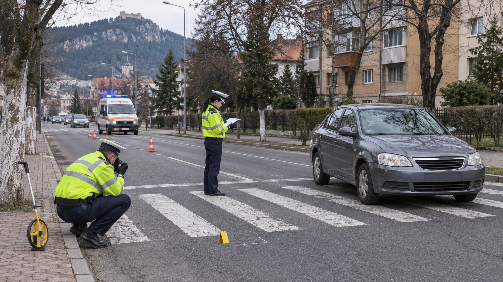

# Neamț: faptele de interes public din buletinul IPJ Neamț din 19 noiembrie

Pentru cititorii din Neamț, informația verificată privește direct faptele de interes public din buletinul ipj neamț din 19 noiembrie.

Conform IPJ Neamț, autoturismul era condus de un bărbat de 73 de ani, iar femeia traversa regulamentar. Victima s-a realizat transportată la spital; șoferul a avut rezultat negativ la alcooltest.

O femeie de 27 de ani s-a realizat lovită de o mașină la 18 noiembrie, în jurul orei 08:40, pe strada Ozana din Piatra Neamț.

Polițiștii continuă cercetările pentru a stabili toate împrejurările accidentului. Informațiile provin din buletinul oficial publicat la 19 noiembrie.

## Surse

- https://nt.politiaromana.ro/ro/stiri-si-media/stiri/buletin-de-presa-19-noiembrie1795074423
