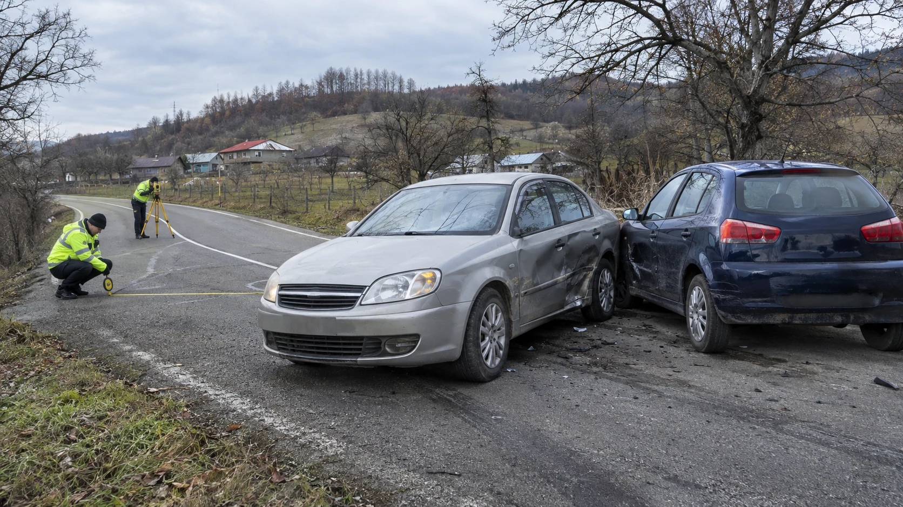

# Măsuri preventive într-un dosar privind copii și mai multe accidente, raportate de IPJ Neamț

Informarea oficială plasează în prim-plan următoarele date: o femeie de 54 de ani a fost amendată cu 3.000 de lei după ce polițiștii au stabilit că trei pisici au fost abandonate la Brusturi, potrivit IPJ Neamț.

## Ce arată informarea oficială

Potrivit comunicatului, copiii au fost preluați de DGASPC. Într-un dosar separat privind presupuse acte de violență asupra unor copii, un bărbat a fost arestat preventiv pentru 30 de zile, iar o femeie a fost plasată sub control judiciar pentru 60 de zile.

În continuare, buletinul mai menționează recuperarea unei biciclete evaluate la 500 de euro, punerea în executare a unui mandat european și accidente la Buruienești, Piatra-Neamț și Trifești.

Documentul mai precizează că măsurile preventive și acuzațiile nu reprezintă hotărâri definitive; prezumția de nevinovăție se aplică.

## Surse

- https://nt.politiaromana.ro/ro/stiri-si-media/stiri/buletin-de-presa-25-noiembrie1795676879
