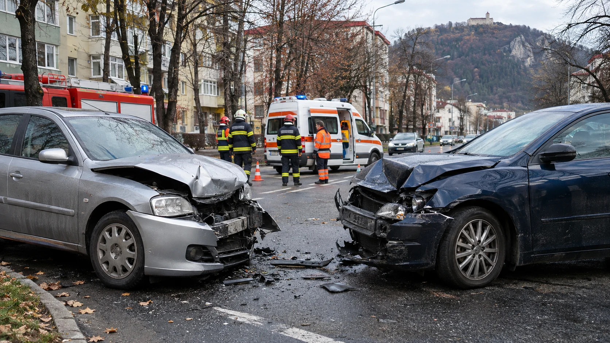

# Accident în Piatra-Neamț, controale la Ion Creangă și un incident de muncă la Săvinești

Informarea oficială plasează în prim-plan următoarele date: ambii șoferi au avut rezultate negative la testarea pentru alcool. Două autoturisme au intrat în coliziune frontală pe strada 1 Decembrie 1918 din Piatra-Neamț, iar un tânăr de 18 ani a fost rănit.

## Ce arată informarea oficială

Potrivit comunicatului, la Ion Creangă, polițiștii au verificat 42 de persoane și 33 de vehicule și au aplicat 17 sancțiuni, însumând aproximativ 5.000 de lei.

În continuare, inspectoratul Teritorial de Muncă a fost informat, iar poliția cercetează împrejurările. La Săvinești, un muncitor de 50 de ani a căzut de la aproximativ 2,90 metri și a fost rănit.

## Surse

- https://nt.politiaromana.ro/ro/stiri-si-media/stiri/buletin-de-presa-26-noiembrie1795677072
