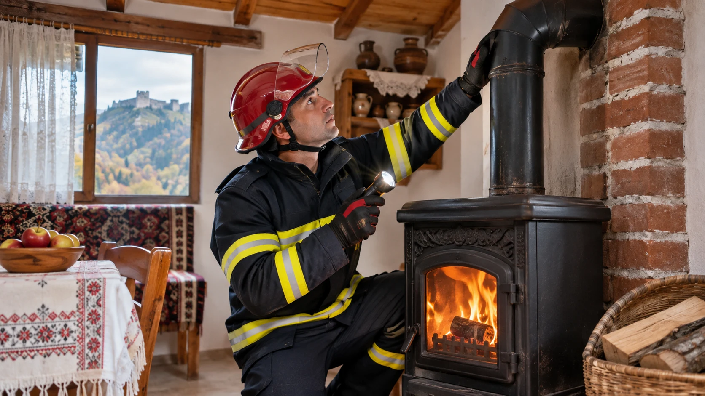

# Măsuri pentru sezonul rece în Neamț: coșuri curățate și centrale verificate

Proprietarii sunt îndemnați să verifice centralele, să curețe și să controleze periodic coșurile de fum prin persoane autorizate și să izoleze traseele fierbinți față de lemn sau alte materiale combustibile. Acesta este efectul imediat al informării publicate de ISU Neamț.

## Detaliile anunțului

Coșurile trebuie izolate corespunzător față de grinzi, căpriori, șarpante și pereți combustibili. Materialul a fost prezentat în conferința de presă din 23 noiembrie și publicat de ISU Neamț în 24 noiembrie.

Programul de iarnă a fost aprobat prin Hotărârea Comitetului Județean pentru Situații de Urgență nr. 14 din 6 noiembrie 2026. ISU avertizează că sobele și coșurile necurățate, deteriorate ori fisurate nu trebuie folosite.

## Informația practică

Calendarul și statutul prezentate sunt cele comunicate de ISU Neamț; orice schimbare ulterioară trebuie verificată la sursa oficială.

## Surse

- https://isunt.igsu.ro/comunicate-de-presa/material-prezentat-in-conferinta-de-presa-din-23.11.2026-1695
