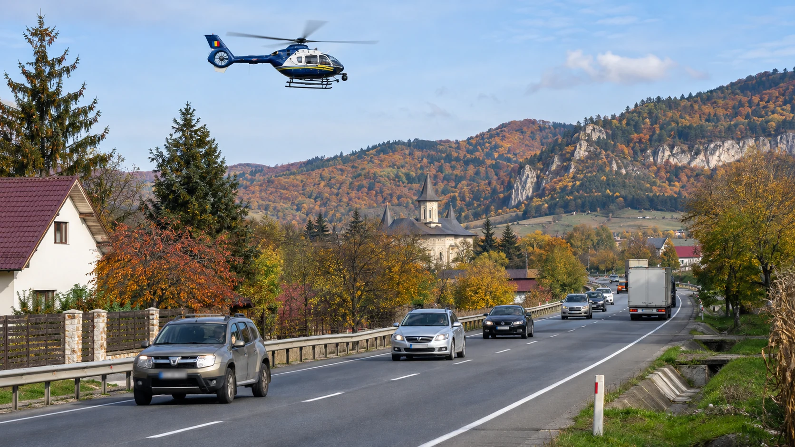

# Elicoptere ale Aviației MAI au sprijinit controalele rutiere din Neamț

Potrivit instituției, acțiunea a urmărit identificarea abaterilor rutiere și sprijinirea echipajelor aflate la sol, pentru prevenirea accidentelor.

## Datele comunicate de instituție

Separat, comunicatul precizează că iPJ Neamț le-a reamintit șoferilor să respecte viteza, distanța de siguranță și regulile de depășire, iar pietonilor și bicicliștilor să se asigure înainte de traversare.

Din punct de vedere practic, elicoptere ale Inspectoratului General de Aviație au survolat principalele drumuri din județul Neamț la 14 noiembrie.

## Surse

- https://nt.politiaromana.ro/ro/stiri-si-media/comunicate/monitorizarea-traficului-rutier-din-neamt
