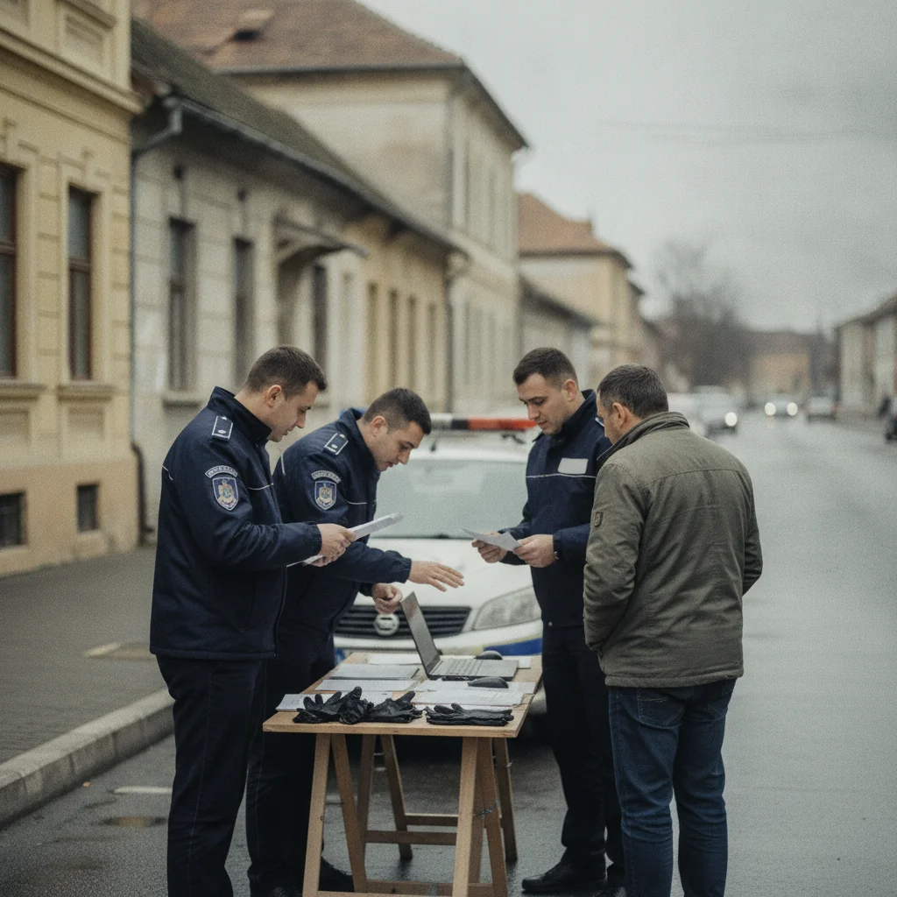

---
postFormat: 'text'
trending: true
title: "Neamț: percheziții în Neamț într-un dosar privind extragerea fără drept a agregatelor minerale"
excerpt: "Ancheta vizează lucrări care ar fi fost realizate fără drept într-o zonă de protecție sanitară a apelor. La verificări au participat specialiști care au făcut măsurători topografice."
featureImg: /images/posts/neamt-perchezitii-agregate-minerale-eneamt-12-noiembrie-2026.webp
thumb: /images/posts/neamt-perchezitii-agregate-minerale-eneamt-12-noiembrie-2026.webp
date: Nov 12 2026
cate: 'Azi in Piatra Neamt'
cate_bg: 'bg-color-red-one'
cate_img: '/images/category/world.png'
post_views: '0 Vizualizari'
post_share: '0 Shares'
author_name: 'Ioana Păduraru'
author_desg: 'Publisher'
author_img: '/images/author/cristina.png'
author_bio: 'Ioana Păduraru este o jurnalistă din Piatra Neamț care surprinde cu sensibilitate și rigurozitate pulsul orașului de sub poalele Pietricicăi. Cu o experiență solidă în presa locală și o pasiune sinceră pentru comunitate, Ioana abordează subiecte diverse – de la știri de actualitate și evenimente culturale, până la interviuri cu oameni care dau viață orașului. Scrie clar, onest și cu o voce apropiată de cititor, oferind zilnic informații relevante pentru toți cei care vor să fie conectați la ce se întâmplă în Piatra Neamț.'
tags:
- Actualitate
- Știri locale

# Neamț: percheziții în Neamț într-un dosar privind extragerea fără drept a agregatelor minerale

Ancheta vizează lucrări care ar fi fost realizate fără drept într-o zonă de protecție sanitară a apelor. La verificări au participat specialiști care au făcut măsurători topografice.

## Ce s-a întâmplat

Polițiștii au ridicat documente, telefoane și alte bunuri considerate relevante pentru stabilirea volumelor extrase și a eventualului prejudiciu.

## Informațiile autorităților

Polițiștii de investigare a criminalității economice au făcut patru percheziții și au pus în executare două mandate de aducere într-un dosar privind extragerea de agregate minerale.

## Ce urmează

Dosarul este coordonat de Parchetul de pe lângă Judecătoria Târgu-Neamț. Persoanele vizate beneficiază de prezumția de nevinovăție.

## Surse

- https://nt.politiaromana.ro/ro/stiri-si-media/comunicate/perchezitii-ale-politistilor-de-la-economic-intr-un-dosar-penal-privind-extragerea-de-agregate-minerale-fara-drept

