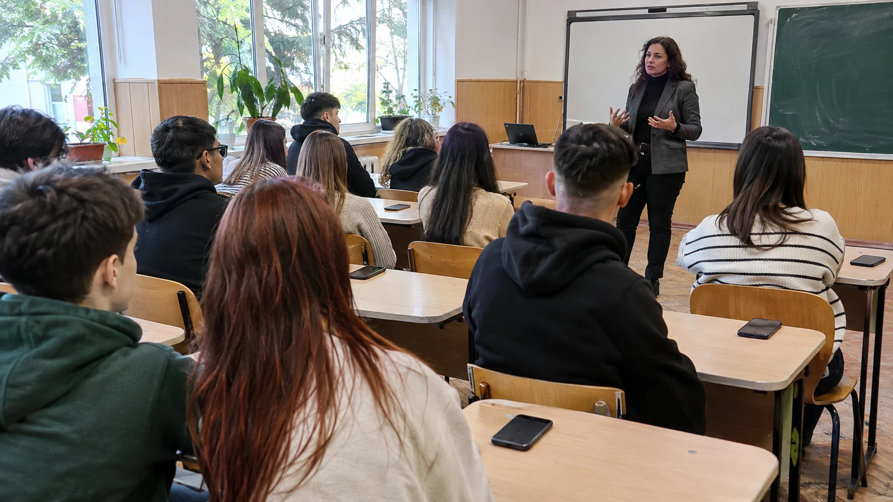

# Prevenirea violenței împotriva femeilor, discutată cu liceeni din Piatra-Neamț

Informarea oficială plasează în prim-plan următoarele date: polițiștii din Neamț au organizat la Colegiul Tehnic „Gheorghe Cartianu” o activitate de prevenire a violenței împotriva femeilor.

## Ce arată informarea oficială

Potrivit comunicatului, discuțiile au vizat recunoașterea abuzului, modalitățile de sesizare, ordinul de protecție și sistemul de monitorizare electronică.

În continuare, comunicatul nu indică numărul participanților și nici un calendar al altor întâlniri. Elevilor le-a fost prezentată și aplicația Bright Sky.

## Surse

- https://nt.politiaromana.ro/ro/stiri-si-media/stiri/ziua-internationala-pentru-eliminarea-violentei-impotriva-femeilor
