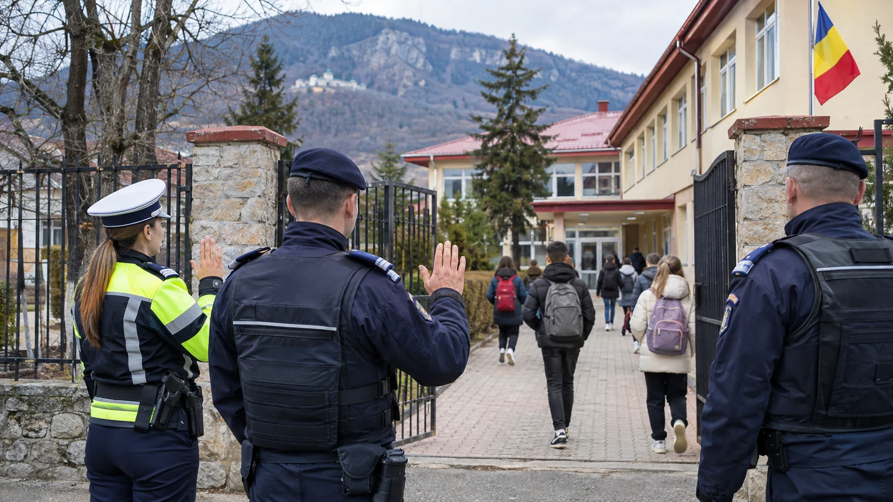

# Neamț: acțiuni ale polițiștilor și jandarmilor pentru siguranța elevilor din Neamț

Au fost aplicate 17 sancțiuni, în valoare totală de 2.297,5 lei, și s-au înregistrat făcute verificări și instruiri la nouă agenți economici și la personalul de pază.

Oamenii legii și jandarmii din Neamț au legitimat 23 de persoane și au verificat 16 autovehicule în apropierea școlilor.

## Surse

- https://nt.politiaromana.ro/ro/stiri-si-media/stiri/activitati-ale-politistilor-si-jandarmilor-pentru-siguranta-elevilor
