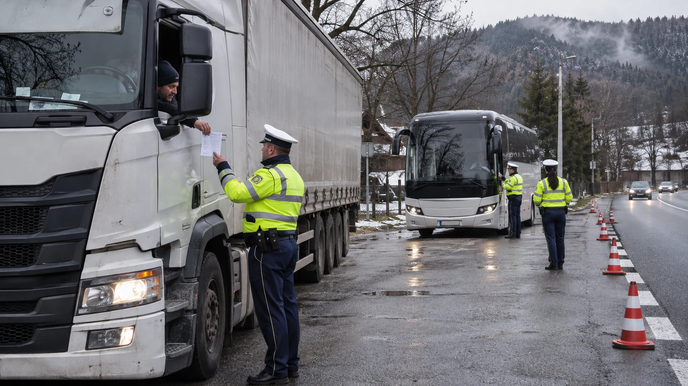

# Transportatorii de persoane și marfă, verificați timp de o săptămână în Neamț

IPJ Neamț indică 22 de sancțiuni pentru viteză, 43 pentru centuri sau dispozitive de retenție, 69 pentru timpii de conducere și odihnă ori folosirea tahografului și 32 pentru alte defecțiuni tehnice.

## Informațiile oficiale

În pagina oficială, totalurile vehiculelor și sancțiunilor sunt afișate ca expresii adunate — „168+283+11+4”, respectiv „63+232” — nu ca totaluri redactate. Din acest motiv, valorile nu sunt prezentate aici ca bilanț oficial consolidat.

Acțiunea ROADPOL TRUCK&BUS s-a desfășurat în județul Neamț între 16 și 22 noiembrie 2026 și a vizat vehiculele de transport public cu peste 8+1 locuri și transportul de marfă.

## Surse

- https://nt.politiaromana.ro/ro/stiri-si-media/stiri/rezultatele-actiunii-aplicate-in-cadrul-actiunii-truck-bus1795508274
