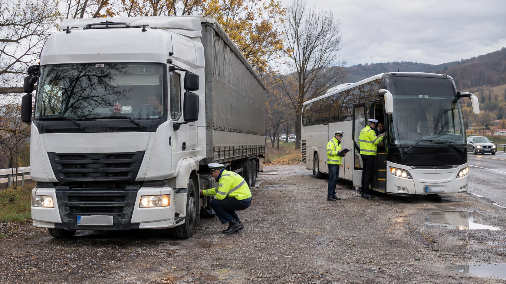

# Truck & Bus în Neamț: 69 de abateri privind timpii de conducere și tahografele

Informarea oficială plasează în prim-plan următoarele date: polițiștii rutieri din Neamț au verificat peste 466 de vehicule de transport în cadrul acțiunii europene Truck & Bus, desfășurate între 16 și 22 noiembrie.

## Ce arată informarea oficială

Potrivit comunicatului, dintre acestea, 22 au privit viteza, 43 centura de siguranță, 69 timpii de conducere, odihnă ori tahografele, iar 32 defecțiunile tehnice. Au fost aplicate 295 de sancțiuni.

În continuare, datele reprezintă bilanțul controalelor și nu indică automat că fiecare vehicul verificat a avut nereguli.

## Surse

- https://nt.politiaromana.ro/ro/stiri-si-media/stiri/rezultatele-actiunii-aplicate-in-cadrul-actiunii-truck-bus1795676738
