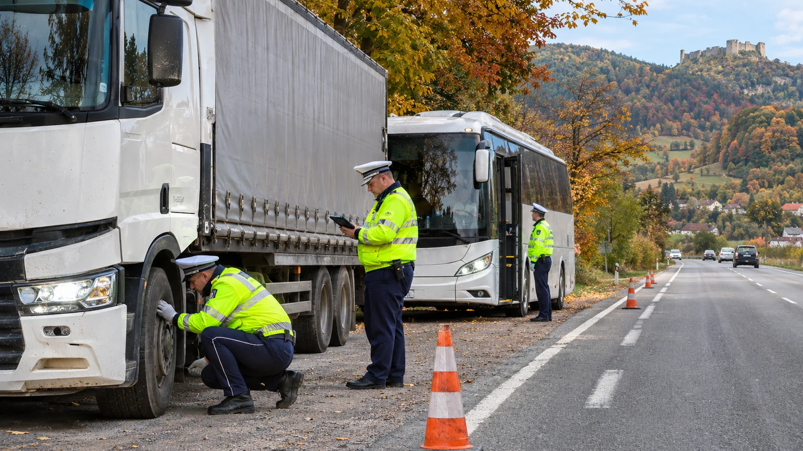

# 295 de sancțiuni după controalele Truck&Bus din Neamț — informațiile oficiale

Conform comunicării instituției, iPJ Neamț a enumerat 22 pentru viteză, 43 pentru nefolosirea centurilor, 69 privind timpii de conducere, odihna ori tahograful și 32 pentru alte defecțiuni tehnice. În total au fost aplicate 295 de sancțiuni.

Conform comunicării instituției, controalele au vizat autobuzele cu peste 8+1 locuri și vehiculele de transport marfă, cu accent pe prevenirea accidentelor și respectarea obligațiilor profesionale.

Conform comunicării instituției, polițiștii rutieri din Neamț au verificat 466 de vehicule în acțiunea ROADPOL Truck&Bus, desfășurată între 16 și 22 noiembrie.

## Surse

- https://nt.politiaromana.ro/ro/stiri-si-media/stiri/rezultatele-actiunii-aplicate-in-cadrul-actiunii-truck-bus1795508274
