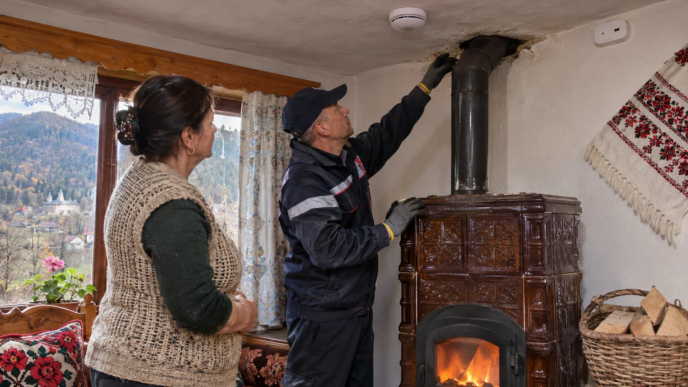

# Măsuri de prevenire a incendiilor în locuințe pentru sezonul rece în Neamț — informațiile oficiale

Potrivit informării oficiale, iSU recomandă curățarea coșurilor de fum de personal autorizat, montarea unei foi metalice de cel puțin 70 pe 50 cm în fața sobei și păstrarea materialelor combustibile la 1–1,5 metri.

Datele publicate de instituție arată că detectoarele de fum, monoxid de carbon și gaz pot semnala din timp un pericol, iar lichidele inflamabile nu trebuie folosite pentru aprinderea focului.

Din comunicatul consultat rezultă că 14 din 6 noiembrie 2026. Măsurile pentru sezonul rece 2026–2027 au fost aprobate prin Hotărârea Comitetului Județean pentru Situații de Urgență nr.

## Surse

- https://isunt.igsu.ro/comunicate-de-presa/material-prezentat-in-conferinta-de-presa-din-23.11.2026-1695
