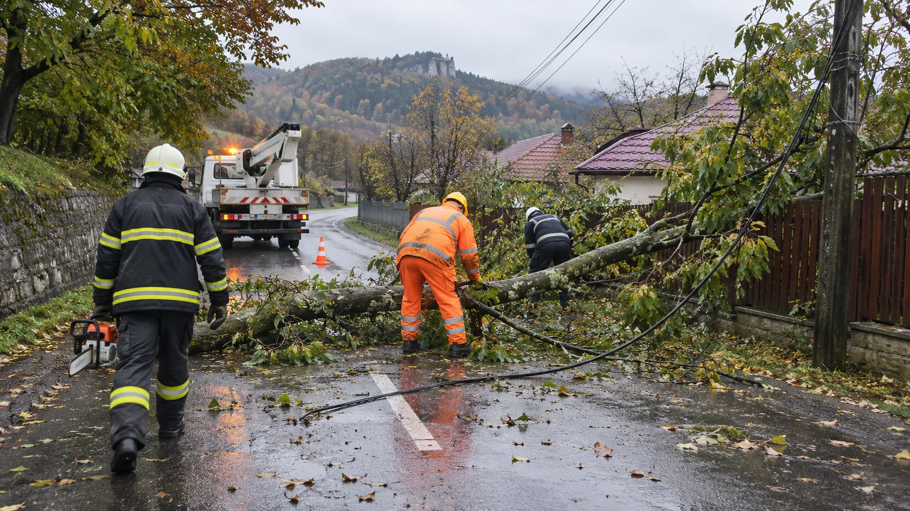

# Peste 11.000 de consumatori fără curent în Neamț, vineri dimineață

Fenomenele meteo din 20 noiembrie au produs intervenții în mai multe localități din Neamț, pentru arbori și cabluri căzute ori elemente care prezentau pericol.

La ora 08:00, Delgaz Grid raporta 11.153 de consumatori fără alimentare cu energie electrică în zonele afectate.

Misiuni au fost raportate în Borlești, Cuejdiu, Piatra Neamț, Bicaz, Tașca și Dănești. În Piatra Neamț au fost semnalate probleme pe străzile Alexandru Lăpușneanu, Mihai Eminescu și Izvoare.

## Surse

- [https://isunt.igsu.ro/comunicate-de-presa/misiuni-desfasurate-in-contextul-manifestarii-fenomenelor-meteorologice-1678](https://isunt.igsu.ro/comunicate-de-presa/misiuni-desfasurate-in-contextul-manifestarii-fenomenelor-meteorologice-1678)
