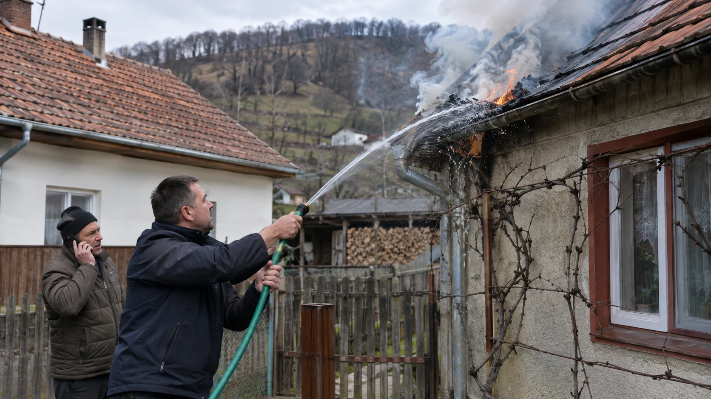

# Doi pompieri aflați în timpul liber au intervenit la incendii în Neamț — datele oficiale

Alexandru a observat un incendiu în Bodești, a sunat la 112 și a folosit un furtun pentru a împiedica extinderea flăcărilor la casa aflată la mai puțin de doi metri. Iulian a intervenit, la rândul său, la o locuință din apropiere. Doi pompieri nemțeni aflați în timpul liber au acționat înaintea sosirii echipajelor la incendii produse la locuințe, potrivit ISU Neamț.

Acțiunile rapide au sprijinit limitarea pagubelor, însă ISU le recomandă populației să nu se expună și să anunțe imediat incendiile la 112. Informația privește direct comunitățile din Neamț.

## Surse

- https://isunt.igsu.ro/comunicate-de-presa/mereu-la-datorie!-1670
