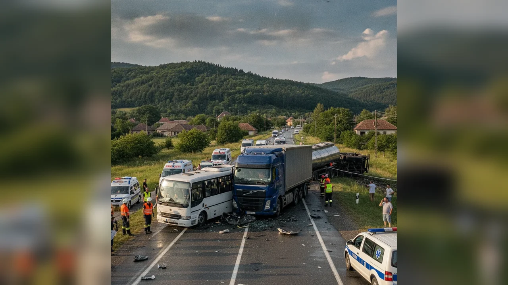

# Coliziune în Roman după nerespectarea semnul Oprire

La data de 1 noiembrie 2026, în jurul orei 12:50, polițiștii Biroului Rutier Roman au fost sesizați prin 112 despre un accident la intersecția străzilor Narciselor cu Cornului, din municipiul Roman.

## Din cercetările poliției

Un tânăr de 26 de ani din Vaslui, pe strada Cornului, nu ar fi respectat indicatorul Oprire la intersecția cu Narciselor și ar fi pătruns în intersecție, intrând în coliziune cu un autoturism condus de un bărbat de 42 de ani din Roman, pe drumul prioritar.

## Urmări

Au rezultat avarii la ambele autoturisme și vătămarea corporală a patru persoane — doi minori și doi majori, pasageri în cele două vehicule. Ambii conducători au fost testați cu etilometrul: rezultate negative. Cercetările continuă în dosar penal.

Persoanele vizate beneficiază de prezumția de nevinovăție.

## Surse

- https://nt.politiaromana.ro/ro/stiri-si-media/stiri/buletin-de-presa-2-noiembrie
