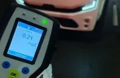

# Șase șoferi testați pozitiv la alcool în controalele de dimineață din Piatra-Neamț și Roznov

Polițiștii rutieri au găsit șase șoferi cu valori între 0,01 și 0,40 mg/l alcool pur în aerul expirat, dintre care trei transportau pasageri.

## Cum și-au continuat pasagerii drumul

Au fost depistați trei șoferi de transport persoane, unul de transport marfă și doi conducători de autoturisme. Acțiunea s-a desfășurat la 11 noiembrie, între orele 04:00 și 08:00. Pasagerii celor trei vehicule s-au aflat preluați de alți șoferi pentru continuarea călătoriei.

## Rezultatele controalelor

Niciun rezultat nu a depășit 0,40 mg/l alcool pur în aerul expirat. Polițiștii au aplicat trei sancțiuni contravenționale.

## Surse

- https://nt.politiaromana.ro/ro/stiri-si-media/stiri/actiune-pentru-siguranta-transportului-de-persoane-soferi-profesionisti-depistati-sub-influenta-alcoolului
