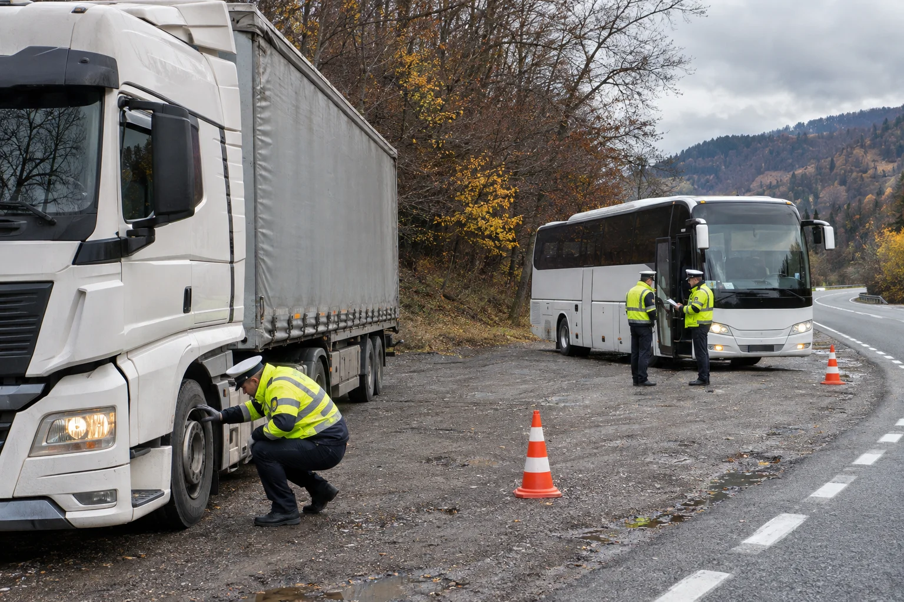

# Operațiunea Truck & Bus în Neamț: controale pe drumurile cu risc ridicat

Acțiunea face parte din calendarul ROADPOL și vizează transportul public de persoane și mărfuri. Informația apare în anunțul oficial care precizează că Polițiștii rutieri din Neamț desfășoară operațiunea Truck & Bus în perioada 16–22 noiembrie 2026.

## Unde și cât durează acțiunea

Echipajele verifică timpii de conducere, pauzele și perioadele de odihnă ale șoferilor. În același anunț, instituția arată că controalele sunt concentrate pe arterele principale și pe tronsoanele cu risc rutier ridicat.

## Ce verifică polițiștii

IPJ Neamț nu a publicat în această informare un bilanț intermediar al sancțiunilor aplicate. Separat, sunt controlate documentele obligatorii, legalitatea transportului, viteza și starea tehnică a vehiculelor.

## Surse

- [Sursa oficială](https://nt.politiaromana.ro/ro/stiri-si-media/stiri/actiuni-pentru-siguranta-rutiera-desfasurate-de-politistii-din-neamt)

